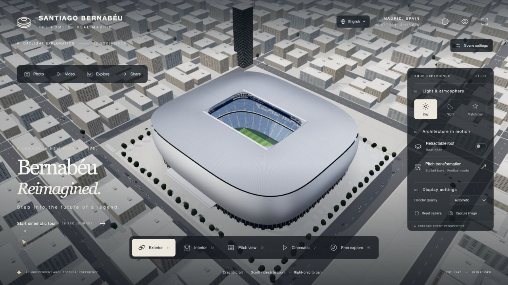

**English** | [简体中文](README.zh-CN.md)

# Santiago Bernabéu 3D Experience

[Live experience](https://bernabeu-architecture-studio.justllama33.chatgpt.site/?lang=en) · [User guide](docs/USER_GUIDE.md) · [Development process](docs/DEVELOPMENT.md)

Explore a real-time 3D interpretation of the renovated Santiago Bernabéu. Take control of the camera, fly past the silver louvered façade and into the stands, open the roof, watch six turf trays move underground, and turn your own viewpoints into photos or videos.



The application uses **Three.js / WebGL**, with `index.html` as its entry point. Stadium geometry, seats, turf, mechanical structures and the surrounding city are generated in code. Runtime assets are local, with no CDN dependency. The interface supports **English, 中文 and Español**.

> An independent procedural architectural reconstruction. The mechanisms, virtual seats and city are simplified. This project is not affiliated with Real Madrid and does not provide an official survey, ticketing service or construction digital twin.

## Maintenance

See [maintenance workflow](docs/MAINTENANCE.md), [release notes](CHANGELOG.md), [downloads](https://github.com/Chcccjj/bernabeu-3d-experience/releases), and [security reporting](SECURITY.md).

## Documentation

Each guide has an **English | 简体中文** link at the top. Navigation stays in the selected documentation language.

| Guide | Contents | 中文 |
| --- | --- | --- |
| [User guide](docs/USER_GUIDE.md) | Setup, controls, roof and pitch, seating, walking, photo/video export, sharing and troubleshooting | [使用手册](docs/USER_GUIDE.zh-CN.md) |
| [Development process](docs/DEVELOPMENT.md) | Reference research, procedural modeling, materials, lighting, interaction, localization and packaging | [制作过程](docs/DEVELOPMENT.zh-CN.md) |
| [Validation scope](docs/VALIDATION.md) | Automated checks, actual browser verification and remaining limits | [验证记录](docs/VALIDATION.zh-CN.md) |
| [Asset acknowledgements](public/ASSET-LICENSES.txt) | HDR environment, dependencies and third-party notices | — |

Live application: [English](https://bernabeu-architecture-studio.justllama33.chatgpt.site/?lang=en) · [中文](https://bernabeu-architecture-studio.justllama33.chatgpt.site/?lang=zh) · [Español](https://bernabeu-architecture-studio.justllama33.chatgpt.site/?lang=es)

## Quick start

Requires **Node.js 24+ (or 22.x starting at 22.13)**.

```sh
git clone https://github.com/Chcccjj/bernabeu-3d-experience.git
cd bernabeu-3d-experience
npm ci
npm run dev
```

Open the address printed by Vite, normally `http://127.0.0.1:5173/`. Installing dependencies initially requires a network connection; development and production previews can then run offline.

The included **[伯纳乌球场.html](伯纳乌球场.html)** is a self-contained offline edition containing JavaScript, CSS and the HDR environment. Download the raw file to use it. If your browser restricts local files, serve it over HTTP. The project's `index.html` needs a development or preview server; GitHub's file preview does not execute the application.

```sh
npm test          # 55 engineering, lifecycle, DOM and localization checks
npm run check     # lint, scoped types, tests, build and artifact/HTTP checks
npm run build     # dist/ plus the self-contained offline HTML edition
npm run preview   # production preview, normally on port 4173
```

## Explore and create

- **Camera views:** Exterior orbit, Interior, Pitch view, a continuous 36-second cinematic tour, and Free explore. View changes use smooth camera transitions.
- **Controls:** Left-drag to orbit or look, wheel to zoom, right-drag to pan. Touch screens support one-finger rotation and two-finger pan/zoom. Free explore uses W/A/S/D or arrows, Q/E for height and Shift for speed, with shell and fixed-roof boundaries.
- **Day / Night / Match day:** Change environmental light, façade lighting, floodlights, screen content and crowds. The displayed score is demonstration content.
- **Retractable roof:** Operate reversible membrane-roof movement along the tracks. Camera journeys into the stadium open the roof first.
- **Pitch transformation:** Six 105 m-long trays move one at a time into a side transfer corridor, then descend to different underground levels. Restoring the pitch follows the same path in reverse; movement can reverse partway through.
- **High-resolution photos:** Six 3D presets, 16:9 / 9:16 / 3:4 / 1:1 composition, field-of-view and exposure controls, PNG/JPEG export without the interface. Desktop long-edge size reaches 3840 px; narrow screens reach 2048 px, subject to GPU texture limits. Browsing resolution is restored after export.
- **Camera-motion recording:** A 15-second exterior orbit, a 36-second cinematic tour or a 15-second roof sequence. Actual canvas recording, preview, early stop and download are supported. Desktop video long edge is 1920 px; narrow screens use 1280 px. Target frame rate is 30 fps, with actual performance depending on the device. MP4 or WebM is selected from real browser support, and the extension matches the container. Moving the page into the background ends and preserves the current clip.
- **Virtual seats:** Choose among 64 rows, four directions and three seating tiers, then move to the eye position of a seat in the model. Click a 3D seat to change position. These virtual identifiers do not correspond to official ticketing.
- **Walking routes:** Follow the player tunnel or walk freely around the pitch using W/A/S/D, Shift or a touch direction pad. Walking boundaries avoid the stands and goals. Optional ambience and footsteps are synthesized without microphone access.
- **Architectural details and cutaway:** Inspect six hotspots with camera transitions and explanatory text. The underground cutaway shows the same six moving turf trays and their supporting racks.
- **Sharing and bookmarks:** Links encode the camera, field of view, lighting, roof, pitch and cutaway states. Recipients can restore viewpoints on the public site. Up to eight bookmarks are stored in the current browser and can be deleted individually.
- **Three-language interface:** Menus, descriptions, controls, progress, export results and accessibility labels update without reloading the scene. User-entered viewpoint names retain their original text. Language precedence is URL parameter, saved selection, a supported browser language, then Chinese fallback. Shared viewpoints include the selected language.
- **Display controls:** Quality selection, camera reset, fullscreen and interface hiding work directly. Use **H** to hide/show the UI, **F** for fullscreen and **Home** to reset. Recording requires `captureStream` and `MediaRecorder`; unsupported browsers receive a clear message.

## Model and rendering

- A perspective scene in meters, with a 105 × 68 m pitch and an approximately 240 × 220 m rounded-rectangle building envelope.
- 48 curved metal louver courses with closed cross-sections, varying contours, panel joints, ground-floor glazing and entrances.
- 64 rows and 53,318 instanced seats across three primary seating tiers, with two VIP glazing bands, stairs, railings and blue/white seat lettering. These are parameters of this model, not official capacity or construction figures.
- Radial roof trusses, an inner ring, suspension elements, tracks, folding membrane sections and a continuous video display.
- Goals, nets, corner flags, benches, pitch-side LEDs, turf trays and their supporting structures.
- Physically based metal, HDR reflections, sun shadows, ACES tone mapping, multisampling and restrained Bloom. High quality enables half-resolution SSAO.
- Curtain-wall mullions, door handles, entrance canopies, plaza seating and planters; the walking tunnel has a geometric opening, ramp, walls and ceiling.
- Instanced seats, crowds, steel members, vehicles, trees and city buildings. Louvers, seats, city geometry and crowd sections use LOD. Reduced-motion preferences disable crowd movement. Automatic quality adjusts pixel ratio based on sustained frame time and gradually recovers when performance improves; photo export uses its own resolution and detailed louver/seat geometry.
- Window resizing, background suspension, WebGL context interruption and GPU resource disposal are handled.

## Source structure

| Path | Responsibility |
| --- | --- |
| `src/scene.js` | Renderer, HDR, lighting, post-processing, assembly, quality and resource lifecycle |
| `src/camera.js` | OrbitControls, transitions, cinematic paths, free movement and boundaries |
| `src/model/` | Louver envelope, seating bowl, roof, six-tray pitch, city and shared geometry |
| `src/main.js`, `styles.css` | UI, accessible status updates, lighting and mechanism controls |
| `src/features/` | Photos, recording, seating, walking, sharing, cutaway and synthesized ambience |
| `src/i18n/` | Chinese, English and Spanish messages, preferences, text updates and language controls |
| `src/assets/` | Local HDR environment; attribution in `public/ASSET-LICENSES.txt` |
| `tests/` | Engineering, interaction-state and localization regression tests |
| `tools/build_standalone.mjs` | Pure Node.js offline HTML packager; the earlier Python version is retained |
| `docs/` | Paired English/Chinese guides, validation notes and actual screenshots |
| `dist/` | Prebuilt static site and offline HTML, reproducible with `npm run build` |
| `.openai/hosting.example.json` | Example static Sites configuration for your own deployment |

## Build and deploy

Run `npm run build`, then deploy the entire `dist/` directory to static hosting. Vite uses relative asset paths (`base: './'`) for subdirectory hosting. See the [deployment steps](docs/USER_GUIDE.md#build-and-deploy).

The repository includes the current source, dependency lockfile, required HDR, tests, build scripts, third-party notices, production output and offline HTML. Dependencies, local backups, temporary verification files and account-specific deployment bindings are excluded.

## References and accuracy

Reference index: [sbp structural information](https://www.sbp.de/en/project/santiago-bernabeu-stadium/), [L35 project description](https://www.l35.com/en/projects/santiago-bernabeu-stadium.html), [gmp project material](https://www.gmp.de/de/bernabeu), and the [official documentary introduction](https://bernabeu.realmadrid.com/en-US/news/bernabeu-documentary). Reference photos informed the reconstruction and are not used as stadium images or background textures.

The urban context is approximate, the tunnel is a visitor space designed for this experience, and the roof folding, storage chamber and transfer mechanism are simplified. Demonstration timings are compressed. The project has no affiliation with Real Madrid.

Third-party notices remain in `public/` and `dist/`. No open-source license has yet been specified for the original project code.
