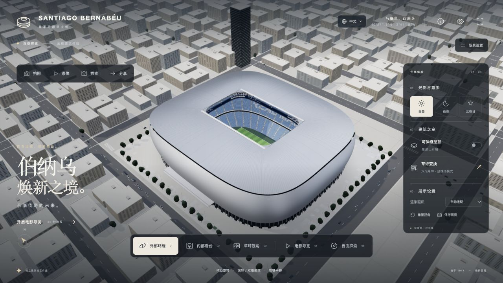
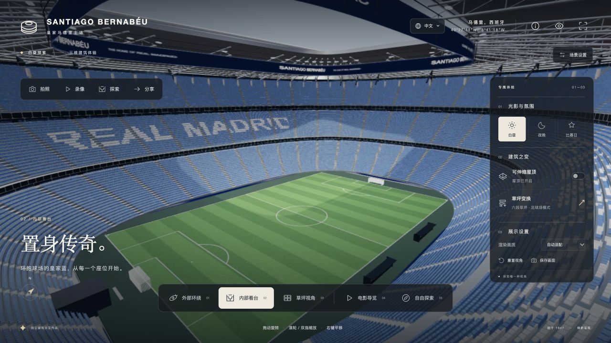

[English](README.md) | **简体中文**

# Santiago Bernabéu 3D Experience

[在线体验](https://bernabeu-architecture-studio.justllama33.chatgpt.site/?lang=zh) · [使用手册](docs/USER_GUIDE.zh-CN.md) · [制作过程](docs/DEVELOPMENT.zh-CN.md)

以翻新后的圣地亚哥·伯纳乌为原型的实时三维建筑探索作品。亲自控制镜头，从银色百叶外立面飞入看台，打开屋顶，观察六段草坪收纳，再把自己的机位导出为照片或视频。



这是基于 Three.js / WebGL 的可交互三维场景，`index.html` 为工程入口。建筑几何、座椅、草坪、机械结构和城市由代码生成，运行时不依赖 CDN。界面支持 **中文、English、Español**。

> 本作品为独立的程序化建筑重建，与皇家马德里无隶属关系。机构、虚拟席位和城市经过简化，不是官方测绘模型、票务系统或施工数字孪生。

## 文档导航

每篇文档顶部均提供 **English | 简体中文** 切换入口。使用手册、制作过程和验证记录均有完整的中英文版本，文档之间的导航会保留当前阅读语言。

| 文档 | 内容 |
| --- | --- |
| [使用手册](docs/USER_GUIDE.zh-CN.md) | 安装运行、镜头操作、屋顶与草坪、选座步行、图片视频导出、分享和常见问题 |
| [制作过程](docs/DEVELOPMENT.zh-CN.md) | 从参考研究、程序建模、材质光照到交互、三语与打包的实现过程 |
| [验证记录](docs/VALIDATION.zh-CN.md) | 自动测试范围、实际浏览器验证和未覆盖的边界 |
| [资源署名](public/ASSET-LICENSES.txt) | HDR 环境、依赖及第三方许可证出处 |

在线体验：[中文](https://bernabeu-architecture-studio.justllama33.chatgpt.site/?lang=zh) · [English](https://bernabeu-architecture-studio.justllama33.chatgpt.site/?lang=en) · [Español](https://bernabeu-architecture-studio.justllama33.chatgpt.site/?lang=es)

## 立即运行

使用 Node.js 22.12 或更新版本：

```sh
git clone https://github.com/Chcccjj/bernabeu-3d-experience.git
cd bernabeu-3d-experience
npm ci
npm run dev
```

打开终端显示的本地地址，通常是 http://127.0.0.1:5173/ 。首次下载依赖后，开发与生产预览都可离线运行。

另附 **[伯纳乌球场.html](伯纳乌球场.html)**：完整离线单文件，包含代码、样式及 HDR 环境资源。下载原始文件后可尝试直接打开；若浏览器限制本地文件，请通过本地 HTTP 服务器访问。工程版 `index.html` 需要通过开发或预览服务器访问。GitHub 的文件预览页不会执行这个应用。

```sh
npm test                # 20 项工程、交互状态与三语完整性测试
npm run build          # 生成 dist/，包含单文件离线版
npm run preview        # 预览正式构建，通常使用 4173 端口
```

## 可操作内容

- **语言切换**：页头和工具面板右上角可选择中文、English、Español；导航、介绍、工具、提示、机械进度、导出结果和无障碍标签同步翻译。切换不会重载场景，用户输入的机位名称保留原文。
- 默认依次采用链接中的 `?lang=zh|en|es`、当前浏览器保存的选择、浏览器语言；无匹配时使用中文。语言选择会保存到浏览器；分享机位链接会附上当前语言。
- **Exterior**：外部透视环绕；左键旋转、滚轮缩放、右键平移，带阻尼。触屏单指旋转、双指缩放和平移。
- **Interior**：通过屋顶开口飞入看台，观察完整草坪、分层座席、VIP 区、钢结构与 360° 视频屏。
- **Pitch View**：草坪中央的低机位视角，可拖动环顾。
- **Cinematic**：36 秒连续曲线路径，经过城市鸟瞰、立面掠飞、屋顶和内部；Esc 或关闭按钮可停止。
- **Free Explore**：W/A/S/D 或方向键移动，Q/E 升降，Shift 加速；拖动环顾。提供外壳与固定屋顶边界约束。
- **Day / Night / Match**：白昼空场、夜景空场、蓝白观众比赛日；实际改变环境光、建筑灯光、泛光灯和屏幕内容。
- **Retractable roof**：两侧 PTFE 膜顶沿轨道伸缩的可逆动画。跨越室内外的相机行程会先打开屋顶。
- **Pitch transformation**：六块 105 米长的草坪按顺序横移至侧方槽口，再下降至不同地下层；恢复时沿原路径返回。两次点击可在途中反转。
- **高清拍照**：六个真实三维机位、16:9 / 9:16 / 3:4 / 1:1 构图、视角与曝光调节；导出 PNG / JPEG，不包含界面。桌面长边最高 3840，窄屏长边最高 2048，且受 GPU 纹理上限约束；导出后恢复浏览分辨率。
- **运镜录像**：15 秒外观环绕、36 秒飞入球场、15 秒屋顶开合；实际录制画布，可预览、提前停止和保存。桌面长边 1920，窄屏 1280，目标 30 fps，实际帧率随设备变化。自动选择浏览器支持的 MP4 或 WebM，文件扩展名与实际格式一致。页面进入后台会结束并保存当前片段，避免导出冻结画面。
- **探索 → 选座**：64 排、四个方向与三层看台选择；镜头进入模型中实际座椅的人眼位置，也可点击座椅换位。排号和席位为本模型的虚拟编号，不对应官方票务。
- **探索 → 路线**：球员通道引导步行与草坪自由步行，W/A/S/D 移动、Shift 加快，触屏提供方向按钮。范围约束避开看台和球门，缓坡连接通道与场地。环境声、脚步声按需开启，由程序合成，不访问麦克风。
- **探索 → 建筑 / 剖面**：六个建筑热点、细节介绍与自然过渡；剖面使用球场中同一批托盘，展示地下支架与真实的分段收纳动画。
- **分享与收藏**：链接记录相机、视角、昼夜、屋顶、草坪及剖面状态。接收者可在公开站点恢复机位；最多 8 个收藏仅保存在当前浏览器，可单独删除。
- 画质选择、相机复位、全屏及隐藏 UI 均有实际功能。拍照和录像不需要远程服务；录像要求浏览器支持 `captureStream` 与 `MediaRecorder`，不支持时会明确提示。
- **H** 隐藏 / 显示界面；**F** 全屏；**Home** 复位相机。



## 模型和渲染

- 米制透视场景，105 × 68 米足球场；外部体量参考约 240 × 220 米的圆角矩形轮廓。
- 48 道具备闭合截面的曲面金属百叶，含起伏轮廓、面板接缝、底层玻璃及入口。
- 64 排、53,318 把座椅实例，三个主要看台区间、两道 VIP 玻璃带、楼梯与栏杆，蓝白座椅文字。以上是本程序模型的构件数，不代表官方容量或施工参数。
- 屋顶径向桁架、内环、吊杆、轨道、折叠膜顶及连续视频显示屏。
- 球门与球网、角旗、替补席、场边 LED、分段草坪托盘及底部支撑。
- PBR 金属、真实 HDR 环境反射、太阳阴影、ACES 色调映射、多重采样及轻量 Bloom；精细模式启用半分辨率 SSAO。
- 底层幕墙竖梃、门把手、入口遮阳构件、广场座椅与种植池；球员通道有真实开口、缓坡、墙面与顶棚。
- 座椅、观众、钢梁、车辆、树木与城市建筑采用实例化；百叶、座椅、城市与分区观众采用 LOD。比赛日观众有轻微运动；减少动态效果偏好会停用观众运动。自动画质根据持续帧耗时降低像素比，并在性能恢复后逐步提高；拍照独立使用目标分辨率和完整百叶 / 座椅几何。
- 处理窗口缩放、后台暂停、WebGL 上下文中断和页面退出时的 GPU 资源释放。

## 源码结构

- `src/scene.js`：渲染器、HDR、光照、后期、装配、质量与资源生命周期。
- `src/camera.js`：OrbitControls、自然过渡、曲线导览、自由移动与边界。
- `src/model/`：百叶外壳、看台、屋顶、六段草坪、城市以及共用几何。
- `src/main.js`、`styles.css`：界面、无障碍状态、模式与机械控制。
- `src/features/`：拍照、录像、选座、步行、分享、剖面与程序环境声。
- `src/i18n/`：中文 / 英文 / 西班牙文词库、语言偏好、局部文本更新与语言选择控件。
- `src/assets/`：本地 HDR 环境；授权与出处见 `public/ASSET-LICENSES.txt`。
- `tests/engineering.test.js`、`tests/experience.test.js`、`tests/i18n.test.js`：工程、交互状态、三语完整性与语言链接回归测试。
- `tools/build_standalone.mjs`：生产构建的离线单文件打包器，仅依赖 Node.js；保留 Python 版供旧流程使用。
- `docs/`：使用手册、制作过程、验证记录和实际运行截图。
- `dist/`：已经构建的静态站点与离线单文件，可由 `npm run build` 重新生成。
- `.openai/hosting.example.json`：Sites 静态部署配置示例；使用自己的站点身份，不复用原作者的部署绑定。

## 构建与部署

运行 `npm run build` 后，将整个 `dist/` 目录部署到支持静态文件的托管服务。Vite 配置使用相对资源路径 `base: './'`，可用于子目录托管。完整步骤见[使用手册](docs/USER_GUIDE.zh-CN.md#构建与部署)。

公开仓库包含当前项目源码、锁定的依赖清单、所需 HDR 资源、测试、构建脚本、第三方声明、构建结果和离线 HTML。`node_modules`、本地备份、临时验证文件和账户部署绑定不随仓库发布。

## 参考与准确性边界

建筑参考：[sbp 结构资料](https://www.sbp.de/en/project/santiago-bernabeu-stadium/)、[L35 建筑说明](https://www.l35.com/en/projects/santiago-bernabeu-stadium.html)、[gmp 实景与设计资料](https://www.gmp.de/de/bernabeu)、[球场官方纪录片介绍](https://bernabeu.realmadrid.com/en-US/news/bernabeu-documentary)。参考照片仅用于研究，没有作为网页画面或背景贴图使用。

本作品为独立的程序化建筑重建，非官方测绘模型或工程数字孪生。周边城市为概括场景，未逐栋测绘；通道为本作品设计的游览空间；屋顶折叠、草坪储存舱与机构经过简化，演示时长压缩，不能作为施工或设备操作依据。比赛日比分为展示内容。与皇家马德里无隶属关系。

第三方资源与依赖声明保留在 `public/` 和 `dist/` 中。本仓库暂未指定原创源码的开源许可证。
