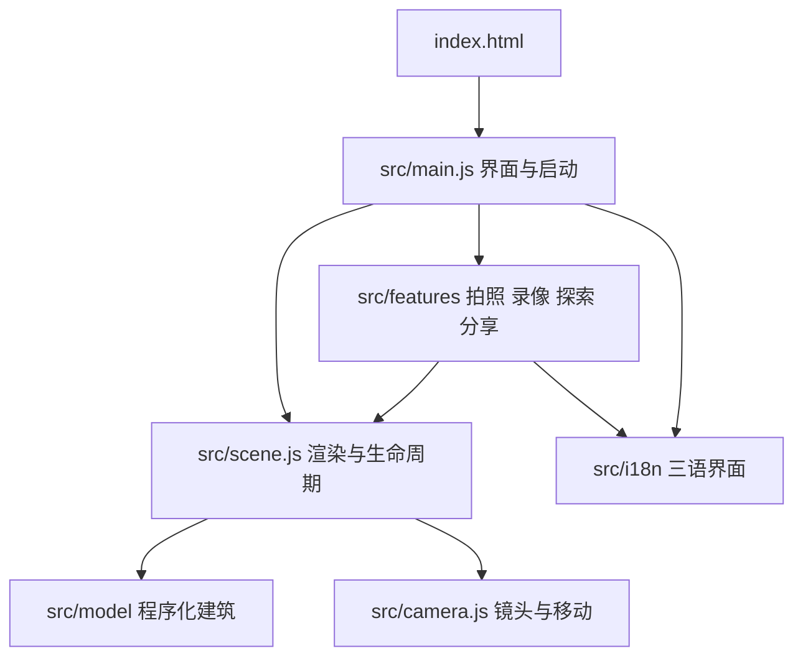

# 制作过程

[返回项目首页](../README.md) · [使用手册](USER_GUIDE.md) · [验证记录](VALIDATION.md)

这份记录按项目的实现阶段梳理关键决定与代码入口，说明画面和交互如何构成。它不是逐条聊天记录，也不为制作时长、人工测绘精度或全设备帧率作推断。

## 1. 从目标中确定建筑特征

最初的目标是让使用者像驾驶无人机一样探索翻新后的伯纳乌：先看到具有辨识度的完整建筑，再自然进入内部，而不是把一张照片或一个椭圆筒当作球场。

参考索引包括 [sbp 结构资料](https://www.sbp.de/en/project/santiago-bernabeu-stadium/)、[L35 项目说明](https://www.l35.com/en/projects/santiago-bernabeu-stadium.html)、[gmp 项目资料](https://www.gmp.de/de/bernabeu)和[官方纪录片介绍](https://bernabeu.realmadrid.com/en-US/news/bernabeu-documentary)。照片用于观察外形、层次和构件关系，没有被放在场景中伪装成模型。

实现时优先保留四个特征：圆角矩形体量、连续起伏的银色百叶、可进入的蓝色看台、固定屋顶与中央开口。周边城市作为尺度参照，采用概括表达。

## 2. 建立可运行的核心场景

工程采用 HTML、CSS 和原生 ES 模块，入口是 `index.html`，用 Vite 开发和打包。Three.js 负责场景，GSAP 负责镜头与机构动画，OrbitControls 负责环绕交互。

球场采用米制尺度；105 × 68 米草坪是内部空间的尺度锚点。场景装配完成前展示加载进度，完成后淡入并推进镜头。窗口缩放、后台暂停、错误提示和 GPU 资源释放统一放在场景生命周期里。

代码入口：[`src/main.js`](../src/main.js)、[`src/scene.js`](../src/scene.js)。

## 3. 用程序几何建立外立面

外壳从可调指数的圆角矩形轮廓生成，不使用简单椭圆柱。各层轮廓叠加高度波动与外鼓，形成有起伏的包裹感。

48 道百叶分别沿轮廓采样。每道使用具有厚度、斜面和闭合边界的截面，随后合并到较少的几何批次中；面板接缝沿同一曲面连接，避免出现独立的笼状线框。底层再加入幕墙、立柱、门把手、入口遮棚和标识。

近距离保留真实百叶几何，远距离切换为经过过滤的表面表达。这样可以减少无人机视角下细密缝隙的闪烁，同时让近看仍有构件厚度。

代码入口：[`src/model/envelope.js`](../src/model/envelope.js)、[`src/model/geometry.js`](../src/model/geometry.js)。

## 4. 完成内部看台与设备

看台按三组阶梯参数生成：22 排、20 排和 22 排，总计 64 排。每一排沿周界布置座椅，预留楼梯通道；蓝白配色形成座椅文字。最终生成 53,318 个座椅位置记录，供实例化绘制、拾取和虚拟选座共同使用。

座椅有近景细节和远景简化几何，不为每把椅子创建独立材质。VIP 玻璃带、层间结构、栏杆、屋顶内环、桁架、360° 屏幕和场边 LED 补齐内部层次。

草坪纹理与标线由 Canvas 程序绘制。球门、线框球网、角旗、替补席和托盘底部支撑都是场景中的几何对象。

代码入口：[`src/model/bowl.js`](../src/model/bowl.js)、[`src/model/roof.js`](../src/model/roof.js)、[`src/model/pitch.js`](../src/model/pitch.js)。

## 5. 让屋顶与草坪真正运动

屋顶分成固定部分和可动膜顶；动画改变可动构件的位置与折叠状态。相机需要穿越屋顶时先打开开口，减少镜头穿模。

草坪采用六个 105 米长的托盘，每个宽度为 `68 / 6` 米。统一的 `trayPose(index, progress)` 把一个总进度分成六段，并为每块托盘计算横移、等待和下降阶段。

关键约束是：同一转运通道内，一块托盘先移入并降低，下一块才进入。恢复时反向读取相同轨迹。草坪分块纹理连续，收纳后分处不同地下高度；剖面展示的就是这六个对象，并非另一段预制动画。

代码入口：[`trayPose`](../src/model/pitch.js)、[`tests/engineering.test.js`](../tests/engineering.test.js)。

## 6. 镜头、游览和虚拟选座

外部环绕使用带阻尼的 OrbitControls。视角切换对位置和观察目标一起插值，电影导览沿连续曲线经过外观、立面、屋顶和内部，避免突然跳转。

自由探索加入外壳、屋顶等边界；步行则使用单独的可行走范围和眼高函数，限制在球员通道、缓坡与草坪附近。通道对应真实几何开口，同时移除入口处穿插的 LED 三角形。

选座功能复用建模阶段的座椅位置记录。二维面板选中排号与方向后，镜头移到对应座椅的人眼位置；三维拾取也能选中实例并高亮。虚拟编号不冒充官方票务数据。

代码入口：[`src/camera.js`](../src/camera.js)、[`src/features/index.js`](../src/features/index.js)、[`src/features/state.js`](../src/features/state.js)。

## 7. 材质、环境与性能

金属立面采用 PBR 材质与本地 HDR 环境反射，结合太阳阴影、ACES 色调映射、抗锯齿与克制的 Bloom。精细模式启用半分辨率 SSAO；夜晚和比赛日改变光照、屏幕及观众表现。

HDR 来自 Poly Haven 的 Potsdamer Platz，署名与授权出处保留在[资源声明](../public/ASSET-LICENSES.txt)。它用于照明和反射，不是球场背景照片。

座椅、观众、城市、树木、车辆和钢梁等重复对象使用实例化。百叶、座椅、城市和观众按距离使用 LOD；自动画质通过持续帧耗时调整像素比，并在有余量时逐步恢复。拍照导出独立使用目标尺寸，完成后恢复浏览设置。

代码入口：[`src/materials.js`](../src/materials.js)、[`src/scene.js`](../src/scene.js)、[`adaptiveRatio`](../src/features/state.js)。

## 8. 从观看扩展到创作与分享

拍照工具临时改变画布尺寸与相机画幅，渲染纯三维画面并导出 PNG/JPEG；界面仍是独立 DOM 层，不进入图片。

录像使用 `captureStream` 和 `MediaRecorder` 录制真实画布。容器根据浏览器实际支持的 MIME 类型选择，不通过改扩展名伪装格式。录像结束后预览并保存；切入后台时保留已经录制的片段。

环境声使用 Web Audio 程序合成，只有使用者开启后才运行，不访问麦克风。分享链接将相机和场景状态编码进 URL hash；读取时先校验格式和数值范围。本地收藏与语言偏好存在当前浏览器，不依赖服务器账户。

代码入口：[`src/features/recorder.js`](../src/features/recorder.js)、[`ambience.js`](../src/features/ambience.js)、[`state.js`](../src/features/state.js)。

## 9. 加入中文、英语和西班牙语

界面采用一份 297 项的三语词库，使用稳定键名管理静态标签与动态文本。进度、错误、导出尺寸和录像停止原因都保留语义键与参数，因此已经显示的结果也能即时翻译。

翻译更新文字节点和无障碍属性，保留按钮图标、输入值与场景对象。切换语言不刷新页面，不重启相机或录像。页头与工作台内各有语言控件，拍照和录像时也能使用。

西语长文本经过桌面和 320/390 px 窄屏检查；数字采用对应语言格式。语言优先顺序为链接参数、已保存选择、支持的浏览器语言和中文默认值。分享链接带上当前语言，使用者输入的机位名称保留原文。

代码入口：[`src/i18n/catalog.js`](../src/i18n/catalog.js)、[`src/i18n/index.js`](../src/i18n/index.js)。

## 10. 打包、验证与公开展示

Vite 输出可部署的 `dist/`。纯 Node.js 打包器再内联代码、样式和 HDR，生成完整离线 HTML；运行时不需要远程渲染或 CDN。

测试分成两层：自动测试检查机械、几何、状态与三语一致性；真实浏览器检查画面、交互、导出文件、录制结果和窄屏布局。自动测试通过不能代替视觉检查。验证范围与限制单独记录在[验证记录](VALIDATION.md)。

本次 GitHub 整理提供当前源码快照、构建产物、运行截图和文档。账户部署绑定、本地备份与临时文件不进入公开仓库。

## 仍然保留的边界

这是程序化建筑可视化作品。外观比例与空间关系以参考资料和视觉判断为依据，没有官方 BIM、测绘点云或设备控制数据。周边城市未逐栋还原，球员通道为本作品的游览空间，地下收纳与屋顶连接经过简化。

下一步可以在取得合适授权和数据后改进真实构件细节、城市环境与机构约束，并扩大 Safari、Edge 和不同移动 GPU 的实测范围。这些方向没有被列为当前已完成功能。
