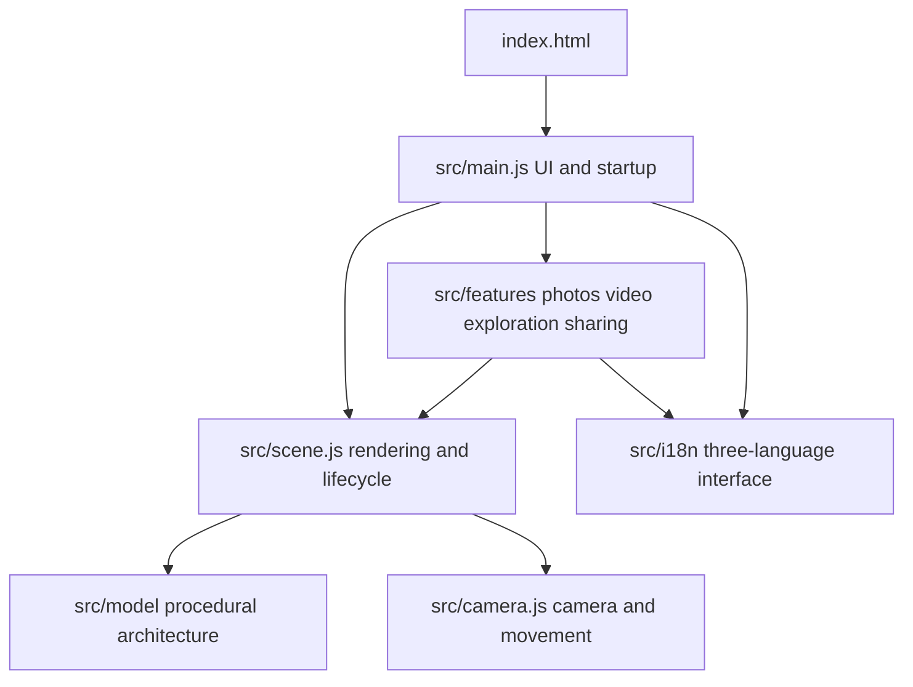

**English** | [简体中文](DEVELOPMENT.zh-CN.md)

# Development process

[Project home](../README.md) · [User guide](USER_GUIDE.md) · [Validation scope](VALIDATION.md)

This guide follows the implementation stages and points to the code behind the visuals and interaction. It describes the decisions supported by the current project, without estimating production hours, survey precision or frame rates for untested devices.

## 1. Identify the architectural features

The initial goal was to let visitors explore the renovated Bernabéu as though piloting a drone: see the complete building, approach its façade and continue naturally into the stadium.

The reference index includes [sbp structural material](https://www.sbp.de/en/project/santiago-bernabeu-stadium/), [L35's project description](https://www.l35.com/en/projects/santiago-bernabeu-stadium.html), [gmp project material](https://www.gmp.de/de/bernabeu), and the [official documentary introduction](https://bernabeu.realmadrid.com/en-US/news/bernabeu-documentary). Photographs informed the massing, layers and relationships between components; the experience renders those components as geometry.

Four features set the modeling priorities: the rounded-rectangle volume, continuous undulating silver louvers, an accessible blue seating bowl, and a fixed roof surrounding a central opening. An approximate city provides a sense of scale.

## 2. Build the core scene

The project uses HTML, CSS and native ES modules, with `index.html` as its entry point and Vite for development and packaging. Three.js manages the scene, GSAP animates the camera and mechanisms, and OrbitControls handles orbit interaction.

The scene uses meters, with the 105 × 68 m pitch anchoring the interior scale. A progress display covers scene assembly, followed by a fade-in and camera approach. Resizing, background suspension, errors and GPU resource disposal belong to the scene lifecycle.

Code: [`src/main.js`](../src/main.js), [`src/scene.js`](../src/scene.js).

## 3. Generate the façade geometry

The envelope starts with a rounded-rectangle outline whose exponent can be adjusted. Height variation and outward swelling change the outline between levels to form the continuous skin.

Each of 48 louver courses samples the perimeter and sweeps a cross-section with thickness, angled faces and closed boundaries. The geometry is batched to reduce draw overhead. Panel joints follow the same varying surface; curtain-wall glazing, columns, door handles, entrance canopies and signs complete the ground level.

Close views retain the full louver geometry. Distant views use a filtered surface representation, reducing shimmer from dense, subpixel gaps while preserving the building's overall appearance.

Code: [`src/model/envelope.js`](../src/model/envelope.js), [`src/model/geometry.js`](../src/model/geometry.js).

## 4. Complete the seating bowl and equipment

Three stepped tiers contain 22, 20 and 22 rows, for a total of 64. Seats follow each row's perimeter with gaps for stairs, while blue/white colors create seat lettering. The final 53,318 seat-position records support instanced rendering, picking and virtual seat selection.

Seats share materials and have detailed near geometry and simpler distant geometry. VIP glazing bands, floor structures, railings, the roof's inner ring and trusses, the wraparound screen and pitch-side LEDs add interior depth.

Canvas drawing generates the turf texture and pitch markings. Goals, line-based nets, corner flags, benches and tray supports are geometric objects in the scene.

Code: [`src/model/bowl.js`](../src/model/bowl.js), [`src/model/roof.js`](../src/model/roof.js), [`src/model/pitch.js`](../src/model/pitch.js).

## 5. Animate the roof and turf trays

The roof separates fixed structure from movable membrane sections. Animation changes the movable components' positions and folding state. Camera journeys through the roof first open the central passage to reduce intersections.

The pitch has six 105 m-long trays, each `68 / 6` m wide. A shared `trayPose(index, progress)` function divides the total progress into six phases and computes each tray's translation, pause and lowering stage.

The transfer corridor accepts one tray at a time: a tray enters and lowers before the next arrives. Restoration reads the same trajectory in reverse. Texture coordinates remain continuous between trays, which finish at different underground heights. The cutaway exposes these same objects and their storage racks.

Code: [`trayPose`](../src/model/pitch.js), [`tests/engineering.test.js`](../tests/engineering.test.js).

## 6. Add camera journeys, walking and virtual seats

The exterior uses damped OrbitControls. Transitions interpolate both the camera position and target. The cinematic journey follows continuous paths through the exterior, façade, roof and interior.

Free exploration constrains movement around the envelope and roof. Walking uses a separate allowed region and eye-height function for the player tunnel, ramp and pitch. The tunnel has a geometric opening, and intersecting LED triangles were removed at its entrance.

Virtual seating reuses the position records generated with the model. A direction and row selection moves the camera to a seat's eye position. Instance picking also selects and highlights seats. The numbering belongs to this model.

Code: [`src/camera.js`](../src/camera.js), [`src/features/index.js`](../src/features/index.js), [`src/features/state.js`](../src/features/state.js).

## 7. Refine materials, lighting and performance

The façade combines physically based metal with local HDR reflections, sun shadows, ACES tone mapping, antialiasing and restrained Bloom. High quality enables half-resolution SSAO. Night and match-day modes change lighting, screens and crowd presentation.

The environment is Poly Haven's Potsdamer Platz. Its source and attribution remain in the [asset acknowledgements](../public/ASSET-LICENSES.txt). It provides illumination and reflections.

Repeated seats, spectators, city buildings, trees, vehicles and steel members use instancing. Louvers, seats, city objects and crowd sections use LOD. Automatic quality adjusts pixel ratio after sustained frame-time changes, with gradual recovery when headroom returns. Photo export uses a separate target resolution and restores browsing settings afterward.

Code: [`src/materials.js`](../src/materials.js), [`src/scene.js`](../src/scene.js), [`adaptiveRatio`](../src/features/state.js).

## 8. Add creation and sharing tools

Photo export temporarily changes canvas dimensions and camera framing, renders the scene, and generates PNG/JPEG files. The interface remains a separate DOM layer and is excluded from the output.

Recording uses `captureStream` and `MediaRecorder` to capture real canvas frames. Container selection follows the browser's supported MIME types, and the output extension matches that selection. A completed clip can be previewed and saved; entering the background preserves the portion already recorded.

Web Audio synthesizes optional ambience after the visitor enables it, without microphone access. Viewpoint links encode camera and scene state in the URL hash; loading validates the format and numeric ranges first. Bookmarks and language preferences stay in the current browser.

Code: [`src/features/recorder.js`](../src/features/recorder.js), [`ambience.js`](../src/features/ambience.js), [`state.js`](../src/features/state.js).

## 9. Localize the application and documentation

The application has a 297-key Chinese, English and Spanish catalog. Stable keys describe static labels and dynamic messages. Progress, errors, export sizes and recording stop reasons retain their keys and parameters, allowing already displayed results to translate immediately.

Text nodes and accessibility attributes update while icons, input values and scene objects stay intact. Language changes do not reload the page, reset the camera or restart recording. Controls appear in both the page header and the workbench.

Spanish long text was checked on desktop and at 320/390 px widths. Numbers follow the selected locale. Application language precedence is URL parameter, saved choice, supported browser language, then Chinese fallback. Shared links carry the chosen language; user-entered viewpoint names remain unchanged.

Repository documentation uses an English `README.md` and a paired `README.zh-CN.md`. User, development and validation guides have corresponding English and `.zh-CN.md` files, each with a language link and navigation in that language. The older `README.en.md` address links to the canonical English README. This documentation choice is independent of the application's three-language setting.

Code: [`src/i18n/catalog.js`](../src/i18n/catalog.js), [`src/i18n/index.js`](../src/i18n/index.js).

## 10. Package and validate the work

Vite produces the deployable `dist/` directory. A pure Node.js packager then inlines code, styles and HDR into a complete offline HTML file. Runtime operation needs neither remote rendering nor a CDN.

Automated tests check mechanisms, geometry, state and localization consistency. Actual browser checks cover visuals, interaction, exported files, recording and narrow-screen layouts. The [validation guide](VALIDATION.md) records their scope and limits separately.

The GitHub repository contains a current source snapshot, production output, actual screenshots and bilingual documentation. Account-specific deployment bindings, local backups and temporary files remain outside the public repository.

## Remaining limits

This is a procedural architectural visualization. Proportions and spatial relationships follow reference material and visual judgment, without official BIM, survey point clouds or equipment-control data. The city is approximate, the tunnel is a visitor route designed for this experience, and the roof connections and underground system are simplified.

Future work could improve component detail, urban context and mechanical constraints when suitable data and permissions are available, and expand testing across Safari, Edge and mobile GPUs. These are future directions.
